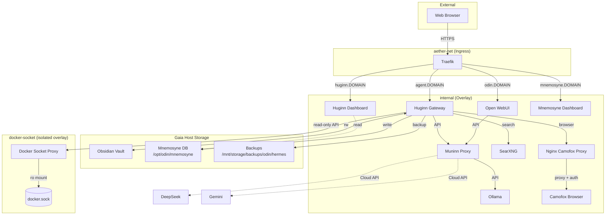

# Odin: AI Orchestration Stack

Odin is the central AI stack for the Yggdrasil home server ecosystem. It runs Hermes Agent (Huginn), Ollama, Muninn (LiteLLM proxy), Open WebUI, and supporting backup services in Docker Swarm on the Gaia host.

---

## Services

| Service | Image | Purpose |
|---------|-------|---------|
| ollama | ollama/ollama:latest | Local LLM inference (CPU-only, 4 CPUs / 12GB RAM) |
| muninn-db | postgres:16-alpine | LiteLLM database |
| muninn | ghcr.io/berriai/litellm-database:main-latest | API proxy — routes all LLM calls with observability |
| open-webui | ghcr.io/open-webui/open-webui:main | Chat UI (LLDAP auth via Cerberus) |
| huginn-gateway | custom (hermes-agent/Dockerfile) | Hermes Agent API server |
| huginn-dashboard | custom (same Dockerfile) | Hermes web dashboard |
| mnemosyne-dashboard | custom (mnemosyne-dashboard/Dockerfile) | Memory visualizer |
| huginn-backup | alpine + sqlite | Nightly SQLite backups, 30-day retention |
| odin-git-backup | custom (git-backup/Dockerfile) | Nightly git backup of /opt/odin (IaC) |
| docker-socket-proxy | tecnativa/docker-socket-proxy:latest | Read-only Docker API (GET/HEAD only) — Swarm service, task and log inspection from Huginn |
| searxng | searxng/searxng:latest | Self-hosted metasearch engine — Hermes web_search backend |
| camofox | ghcr.io/redf0x1/camofox-browser | Anti-detection browser — Hermes stealth browser (Firefox + C++ fingerprint spoofing) |


## Architecture



Three networks: `aether-net` (external, shared with Traefik), `internal` (isolated overlay), and `docker-socket` (isolated overlay whose only members are `huginn-gateway` and `docker-socket-proxy`).

---

## LLM Backend

Ollama is installed for local inference but the Gaia host is CPU-only — Qwen 2.5 was too slow for agent workloads. Pivoted to DeepSeek as the primary backend, routed through Muninn to preserve unified observability:

```
Hermes Agent → Muninn (http://muninn:4000/v1) → DeepSeek API
```

Current models: `agent-loop` (fast tier, now the **fallback** for the main agent loop — see below), `agent-delegate` (delegation/coding subagents, reasoning tier), `memory-extract` (Mnemosyne memory consolidation, fast tier), `compress` (Hermes context compression summarizer, fast tier), `local-model:latest` (Open WebUI default, lightweight local). These are role-named aliases defined in `config/muninn/config.yaml.template`; each upstream DeepSeek slug appears exactly once, as a YAML anchor (`&flash`, `&pro`), so repointing a role at a different model is a one-line edit there. `agent-auto` (complexity router: fast tier for simple/medium, reasoning tier for complex/reasoning) is kept defined in the Muninn config but dormant — point `AGENT_MODEL` at it to re-enable auto-routing.

Live model switching via `/model` command in any chat interface.

### Primary model and fallback (`model:` + `fallback_providers:`)

The **main agent conversation loop** — every turn, not just delegated work — runs on the **Antigravity (Google AI Pro) subscription** first, via the official `agy` CLI, and rotates to **DeepSeek through Muninn** when the subscription usage limit is hit. The subscription is a fixed monthly fee, so it is used first and the metered DeepSeek API is only touched once the subscription wall is reached.

```
main agent loop → Antigravity subscription (agy CLI, gemini-3.1-pro)
                ↘ usage limit reached → Muninn (custom) → DeepSeek V4-Pro (agent-delegate)
```

`AGENT_MODEL` therefore names a model the `agy` plugin exposes (`gemini-3.1-pro`, `claude-opus-4-6-thinking`, …) — **not** a muninn alias like `agent-loop`, which would resolve against the wrong provider now that the `model:` block points at the plugin.

This is a native Hermes fallback chain (`fallback_providers`), not custom code. Hermes classifies `agy`'s `usage_limit_reached` error as a non-retryable rate_limit/billing verdict and rotates the chain eagerly.

Compression is deliberately pinned **off** the subscription (`auxiliary.compression.provider: custom` → muninn `compress`). An auxiliary task whose provider is unset inherits the MAIN provider, so leaving it unset would burn subscription quota on every history compaction.

Delegated subagents also run on the subscription (`delegation.provider: antigravity-subscription-directsdk`, model `gemini-3.1-pro`), but their fallback leg is the **Gemini API pro** model (`gemini-2.5-pro` via Muninn), not the subscription's own `gemini-3.1-pro`: the subscription meters Flash and Pro from a single "Gemini Models" quota group, so an in-subscription hop cannot carry traffic once that group is exhausted. A pinned `delegation` block never inherits the parent's chain, so this leg is declared inline there too.

Deliberately absent from every chain: the Gemini API **flash** model. Its quota burns far too fast to be worth a chain slot.

Two prerequisites, both wired in this repo and easy to break:

- **`agy` binary + plugin.** The Antigravity CLI is installed into the image at `/opt/agy` (symlinked to `/usr/local/bin/agy`), and the model-provider plugin `antigravity-subscription-directsdk` is cloned at the catalog-pinned commit into the **bundled image layer** at `/opt/hermes/plugins/model-providers/`. Installing it under `$HERMES_HOME/plugins` instead would be shadowed by the `/opt/odin/hermes:/opt/data` volume mount and the provider would silently not exist.
- **Subscription login.** `agy` authenticates with an OAuth token, not an API key. Run `agy` once inside the container to sign in; the token persists at `$HOME/.gemini/antigravity-cli/` — and `entrypoint.sh` sets `HOME=/opt/data/home`, on the persistent volume, so the login survives restarts. Without this the Antigravity leg fails and every turn falls straight through to DeepSeek.

The fallback leg resolves its credential by variable **name**: the chain uses `key_env: MUNINN_MASTER_KEY`, so `MUNINN_MASTER_KEY` must be present in the gateway container's environment (not merely aliased to `OPENAI_API_KEY`).

---

## Accessing Huginn

- **Discord Bot** — mention the bot in allowed channels. `/new` to reset.
- **Huginn Dashboard** — `https://huginn.DOMAIN` — chat, sessions, skills, memory.
- **Open WebUI** — `https://odin.DOMAIN` — select `hermes-agent` model.
- **Direct API** — `POST https://agent.DOMAIN/v1/chat/completions` (OpenAI-compatible).
- **Mnemosyne** — `https://mnemosyne.DOMAIN` — memory constellation map and timeline.

---

## Deploying

Prerequisites: environment variables in `.env` or GitHub Secrets.

```bash
# Direct (from Swarm manager)
docker stack deploy -c docker-compose.yml odin

# Remote trigger (from inside Hermes container)
gh workflow run deploy --repo yggdrasil-lab/odin
```

Deploy workflow runs on the self-hosted `gaia` runner. Pushes to main auto-trigger deploy.

---

## Details

Full documentation with service deep-dives, deployment pipeline, backup architecture, Hermes container internals, and pitfalls: see the Odin Stack reference in the vault under `Areas/90-Infrastructure/Odin/Odin Stack.md`.
