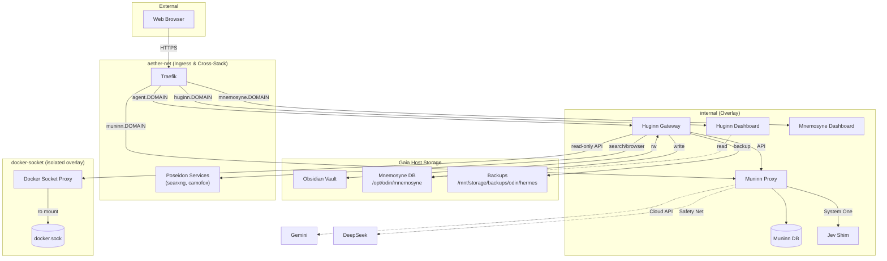

# Odin: AI Orchestration Stack

Odin is the central AI stack for the Yggdrasil home server ecosystem. It runs minimal Hermes Agent (`huginn-gateway` and `huginn-dashboard`), Muninn (LiteLLM proxy), `jev-shim` (TypeSafe Jev translation shim), `mnemosyne-dashboard`, and supporting infrastructure services in Docker Swarm on the Gaia host.

---

## Services

| Service | Image | Purpose |
|---------|-------|---------|
| muninn-db | postgres:16-alpine | LiteLLM PostgreSQL database |
| muninn | ghcr.io/berriai/litellm-database:main-latest | API proxy: routes role aliases with spend observability and fallbacks |
| jev-shim | custom (jev-shim/Dockerfile) | OpenAI-compatible shim for TypeSafe Jev System One decision gates |
| huginn-gateway | custom (hermes-agent/Dockerfile) | Minimal Hermes Agent API and Discord gateway (`odin` coordinator) |
| huginn-dashboard | custom (same Dockerfile) | Hermes web dashboard (`huginn.DOMAIN`) |
| mnemosyne-dashboard | custom (mnemosyne-dashboard/Dockerfile) | Memory visualizer (`mnemosyne.DOMAIN`) |
| docker-socket-proxy | tecnativa/docker-socket-proxy:latest | Read-only Docker API (GET/HEAD only): Swarm service, task, and log inspection |

External web search (`poseidon_searxng`) and stealth browser (`poseidon_camofox`) services run in the Poseidon stack and are consumed over `aether-net` / internal endpoints via `SEARXNG_URL` and `CAMOFOX_URL`.

## Architecture



Three networks: `aether-net` (external, shared with Traefik and Poseidon), `internal` (isolated overlay), and `docker-socket` (isolated overlay whose only members are `huginn-gateway` and `docker-socket-proxy`).

---

## Runtime Architecture (`odin_runtime` & `patch_runner`)

Odin isolates custom Hermes Agent and `antigravity-subscription-directsdk` runtime behavior in an installable stdlib package (`hermes-agent/odin_runtime/`) installed into `/opt/hermes/.venv/lib/python3.14/site-packages/odin_runtime`, driven by declarative build-time hook specs (`hermes-agent/patches/{patch_runner,specs}.py`):

- **`odin_runtime.agy_policy`**: `AgyPolicy.from_env(env)` allowlist enforcement (`HERMES_AGY_ALLOWED_MODELS`, `HERMES_AGY_ALLOWED_EFFORTS`), `$HOME` derivation from resolved token paths, catalog filtering, and operational `PREAMBLE_RULES`.
- **`odin_runtime.agy_stream_guard`**: `UsageSnapshot` / `account_usage` (prompt = uncached input + cached, reasoning token preservation), bounded 1x `native_tool_decision`, and `is_output_cap` error matching.
- **`odin_runtime.pm_venv_bridge`**: `link_base_site` (`odin-base-site.pth`) and `merged_pythonpath` preserving image-baked `/opt/hermes/.venv` packages across Hermes PM environments.
- **`odin_runtime.pre_compress_handover`**: Auckland Daily Journal pre-compression checkpointing, replay suppression, and Discord thread handover behind `DiscordThreadPort` (`UrllibDiscordAdapter` routing strictly via `DISCORD_CHANNEL_INFO_ID`, `FakeDiscordAdapter` in tests).
- **`patches/patch_runner.py` & `patches/specs.py`**: Declarative `Hunk` / `PatchSpec` engine enforcing `count == 1`, idempotent markers, `retired_probe` negative assertions, `--audit`/`--dry-run` modes, atomic `ast.parse` + `py_compile`, and post-apply upstream plugin unittest verification.

---

## LLM Backend

Role-named aliases are defined in `config/muninn/config.yaml.template` using YAML anchors (`&gemini_38_flash`, `&gemini_35_flash_lite`, `&flash`, `&pro`):

- `agent-loop`: heavy scheduled crons and Antigravity overflow on Gemini 3.8 Flash -> DeepSeek V4-Flash
- `agent-delegate`: delegation primary on Gemini 3.8 Flash -> DeepSeek V4-Pro
- `memory-extract`: Mnemosyne memory consolidation on Gemini 3.8 Flash -> DeepSeek V4-Flash
- `app-synthesize`: Kratos/Plutus synthesis on Gemini 3.8 Flash -> DeepSeek V4-Flash
- `gemini-4-hydrogen`: Plutus receipt vision on native Gemini 3.8 Flash -> Gemini 3.5 Flash-Lite -> DeepSeek V4-Flash
- `compress`: Hermes context compression summarizer on Gemini 3.5 Flash-Lite -> DeepSeek V4-Flash
- `agent-monitor` / `jev-decision`: TypeSafe Jev System One scoring and binary gating via `jev-shim`

### Four-Pool AI Routing (`model:`, `delegation:`, `providers.muninn`, `fallback_providers:`)

AI inference is partitioned across four isolated quota pools:

1. **Pool 1 (Google AI Ultra Gemini, 100% Antigravity IDE only)**: All five Court of Odin IDE specialists (`huginn`, `forseti`, `vor`, `saga` on `gemini-4-neon-high`; `sindri` on `gemini-pro-orchestrator-neon`) and interactive IDE turns. Zero Pool 1 usage in Hermes or Muninn.
2. **Pool 2 (Google AI Ultra Claude, minimal Hermes `odin` only)**: Interactive Discord and lightweight scheduled jobs (`morning-executive-copilot`, `training-directive`) run on `claude-sonnet-5-5-high` via the official `agy` CLI (`antigravity-subscription-directsdk`), locked strictly by `HERMES_AGY_ALLOWED_MODELS=claude-sonnet-5-5` and `HERMES_AGY_ALLOWED_EFFORTS=low,medium,high`. Hermes intentionally uses **direct models** rather than `gemini-pro-orchestrator-*`, because Hermes manages its own `<tool_call>` loop externally and Orchestrator models re-enter Plan Mode on every incoming turn.
3. **Free `$40/mo` Gemini API Credits (Muninn, `$35/30d` cap -> DeepSeek safety net)**:
   - Heavy scheduled crons (`daily-briefing`, `weekly-topic-watch`, `mnemosyne-dreaming-consolidation`) pin to named `providers.muninn` (`model: "agent-loop"`, `gemini/gemini-3.8-flash`) authenticated with `MUNINN_MASTER_KEY`.
   - Subagent `delegation` runs primarily on `providers.muninn` `agent-delegate` (`gemini/gemini-3.8-flash`), falling back to `claude-sonnet-5-5-high`.
   - Stack synthesis (`app-synthesize`), memory extraction (`memory-extract`), and Plutus receipt vision (`gemini-4-hydrogen`) run natively on `gemini/gemini-3.8-flash`, while `compress` stays on `gemini/gemini-3.5-flash-lite`.
4. **TypeSafe Jev (`$50` prepaid)**: Unchanged fast zero-output classification and gating (`jev-decision`, `agent-monitor`, `jev-shim`).

```
main agent loop -> Antigravity Pool 2 (agy CLI, claude-sonnet-5-5-high)
                -> usage limit reached -> Muninn (custom) -> Gemini 3.8 Flash / DeepSeek V4-Flash (agent-loop)

delegation      -> Muninn (providers.muninn, agent-delegate -> Gemini 3.8 Flash / DeepSeek V4-Pro)
                -> fallback -> Antigravity Pool 2 (claude-sonnet-5-5-high)
```

`AGENT_MODEL` therefore names `claude-sonnet-5-5-high` exposed by the `agy` plugin - **not** a muninn alias like `agent-loop`, which would resolve against the wrong provider now that the `model:` block points at the plugin.

This is a native Hermes fallback chain (`fallback_providers`), not custom code. Hermes classifies `agy`'s `usage_limit_reached` error as a non-retryable rate_limit/billing verdict and fails over directly to Muninn without touching Pool 1 Gemini.

Compression, memory consolidation, background review, and title generation run primarily on Muninn (`compress` / `memory-extract` / `app-synthesize`) and fall back strictly to `claude-sonnet-5-5-medium` (or `claude-sonnet-5-5-low` for `title_generation`).

Hermes runs strictly in minimal single-coordinator mode (`odin` only, zero sub-profiles) for cron jobs, Discord, and auto-ingestions. All 5 Court of Odin specialists (`huginn`, `sindri`, `forseti`, `vor`, `saga`) run natively inside Antigravity IDE.

Deliberately absent from every chain: the **metered** legacy Gemini 2.5 API (`gemini-2.5-flash` / `gemini-2.5-pro`) and Pool 1 Gemini models in Hermes. Pool 1 stays isolated for Antigravity IDE, while Muninn routes within the `$35/30d` cap inside `$40/mo` Google Developer Program credits before falling back to DeepSeek.

Two prerequisites, both wired in this repo and easy to break:

- **`agy` binary + plugin.** The Antigravity CLI is installed into the image at `/opt/agy` (symlinked to `/usr/local/bin/agy`), and the model-provider plugin `antigravity-subscription-directsdk` is cloned at the catalog-pinned commit into the **bundled image layer** at `/opt/hermes/plugins/model-providers/`. Installing it under `$HERMES_HOME/plugins` instead would be shadowed by the `/opt/odin/hermes:/opt/data` volume mount and the provider would silently not exist.
- **Subscription login mounted from host.** `agy` authenticates with an OAuth token, **not** a Gemini API key, and the token is read from a **file** at `$HOME/.gemini/antigravity-cli/` (the plugin looks for `jetski-standalone-oauth-token`, then `antigravity-oauth-token`). The host's `~/.gemini/antigravity-cli` directory is mounted directly into both `huginn-gateway` and `huginn-dashboard` at `/opt/data/home/.gemini/antigravity-cli`.

  Authenticate `agy` on the Gaia host under your regular user account from a real TTY:

  ```bash
  # Run on gaia from your regular user shell:
  agy
  ```

  Verify `~/.gemini/antigravity-cli/` holds `jetski-standalone-oauth-token` (or `antigravity-oauth-token`). Because it is bind-mounted directly into the container, token refreshes persist on the host file. Always run interactive `agy` login directly on Gaia rather than via `docker exec` (the socket proxy refuses `exec`).

The fallback leg resolves its credential by variable **name**: the chain uses `key_env: MUNINN_MASTER_KEY`, so `MUNINN_MASTER_KEY` must be present in the gateway container's environment (not merely aliased to `OPENAI_API_KEY`).

### Decision-Only Model Triage (TypeSafe Jev)

For high-frequency, low-complexity gating tasks - such as topic-watch sweep materiality filtering, silent-tick suppression, and component price threshold validation - Hermes integrates TypeSafe AI's **Jev** (`jev-latest`) decision model. When `TYPESAFE_API_KEY` is provisioned, high-volume classification (Noul, Score, Choice) runs through Jev's calibrated confidence gate first, dropping noise and silent ticks without burning general LLM conversation tokens.

---

## Accessing Huginn

- **Discord Bot**: mention the bot in allowed channels. `/new` to reset.
- **Huginn Dashboard**: `https://huginn.DOMAIN` (chat, sessions, skills, memory).
- **Direct API**: `POST https://agent.DOMAIN/v1/chat/completions` (OpenAI-compatible).
- **Mnemosyne**: `https://mnemosyne.DOMAIN` (memory constellation map and timeline).
- **Muninn Dashboard**: `https://muninn.DOMAIN/ui` (LiteLLM observability).

---

## Deploying

Prerequisites: environment variables in `.env` or GitHub Secrets.

```bash
# Direct (from Swarm manager)
docker stack deploy -c docker-compose.yml odin

# Remote trigger (from inside Hermes container)
gh workflow run deploy --repo yggdrasil-lab/odin
```

Deploy workflow runs on the self-hosted `gaia` runner. Pushes to main auto-trigger deploy.

---

## Details

Full documentation with service deep-dives, deployment pipeline, backup architecture, Hermes container internals, and pitfalls: see the Odin Stack reference in the vault under `Areas/90-Infrastructure/Odin/Odin Stack.md`.
